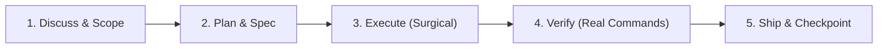

# Unified Autonomous Engineering Core (GSD + Ralph + Roo + CodeRabbit)

The **Autonomous Core** is an end-to-end, zero-babysitting software engineering framework that drives complex development tasks from specification to deployment with mathematical precision, strict context hygiene, and uncompromising code quality.

---

## 1. The 5-Phase Execution Cycle (Open GSD Paradigm)



1. **Phase 1: Discuss & Scope:**
   - Uncover user intent, environment parameters, operational constraints, and security requirements upfront.
   - Clarify edge cases before touching code.
2. **Phase 2: Plan & Spec:**
   - Deconstruct requirements into atomic, independently verifiable tasks in `prd.json`.
   - Update the Roo Memory Bank (`./memory-bank/`) and the root `journal.md`.
3. **Phase 3: Execute (Surgical Implementation):**
   - Implement one unit at a time with minimum blast radius. Keep changes strictly bounded to target files.
4. **Phase 4: Verify (Zero Assumptions):**
   - Validate with real commands: compilers, typechecks, linters, unit tests, and integration test runners.
   - Never assume code works without executable verification output.
5. **Phase 5: Ship & Checkpoint:**
   - Mark task `passes: true` in `prd.json`, append learnings to `progress.txt`, update `memory-bank/progress.md`, and make a clean atomic Git commit.

---

## 2. Dynamic Persona Modes (Roo Code Paradigm)

Dynamically adopt the appropriate mode based on the current problem stage:

| Mode | Trigger Condition | Primary Deliverable / Behavior |
| :--- | :--- | :--- |
| **Architect Mode** | Inception of projects, major refactors, or new architectural subsystems. | Specs, trade-off analyses, data-flow diagrams, `journal.md` updates, and Memory Bank scaffolding. |
| **Code Mode** | Active implementation of scoped PRD stories. | Surgical, type-safe, modular implementation. Zero scope creep. |
| **Debug Mode** | Failing tests, runtime errors, performance regressions, or test anomalies. | **4-Step Diagnosis:**<br>1. Observe symptom & extract full error trace.<br>2. Formulate explicit, falsifiable hypothesis.<br>3. Reproduce / isolate with minimal test case.<br>4. Apply surgical fix and verify regression-free. Never make random shotgun changes. |
| **Ask Mode** | User requests code walkthroughs, codebase audits, or security reviews. | Read-only analysis without file mutations. |

---

## 3. Persistent Memory & Context Hygiene

Maintain structured external state on disk to prevent LLM context rot:

```
./memory-bank/
├── projectBrief.md    # Core goals, scope, and target metrics
├── productContext.md  # User personas, UX priorities, and problems solved
├── systemPatterns.md  # Component relationships, design patterns, architecture
├── techContext.md     # Runtimes, compilers, libraries, dev scripts
├── activeContext.md   # Current active story, recent changes, immediate next steps
└── progress.md        # What works, pending items, known risks
journal.md             # The technical "whys and hows" behind architectural choices
prd.json               # Atomic user stories with acceptance criteria and "passes: bool"
progress.txt           # Append-only chronological run log
```

---

## 4. Autonomous PRD Loop (Ralph Paradigm)

Execute in a continuous, zero-babysitting loop:
1. Read `prd.json` and pick the next pending story (`passes: false`).
2. Switch to **Code Mode**: Implement the minimal code required to satisfy the story's acceptance criteria.
3. Switch to **Verify Mode**: Run compilers, linters, and test suites.
4. If failures occur, switch to **Debug Mode**: Isolate and fix.
5. Once all acceptance criteria are verified:
   - Mark `"passes": true` in `prd.json`.
   - Append execution outcome and learnings to `progress.txt`.
   - Proceed autonomously to the next pending item without pausing for obvious next steps.

---

## 5. Pre-Completion Quality Gate (CodeRabbit Multi-Lens Review)

Before marking any story complete, run through the **5 CodeRabbit Lenses**:

1. **Logic & Correctness:** Boundary checks, null safety, race conditions, unhandled exceptions, correct control flow.
2. **Security & Vulnerabilities (Security Fortress):**
   - **Injection:** Parameterize all queries (SQLi, NoSQLi). Eliminate dynamic template evaluation (SSTI). Block ReDoS with linear-time regex.
   - **Access Control:** Enforce tenant/ownership checks on every server endpoint (BOLA/IDOR). Enable Postgres RLS.
   - **Secrets & Sessions:** Zero client-side API keys (`NEXT_PUBLIC_` / `VITE_`). Store auth tokens strictly in `HttpOnly`, `Secure`, `SameSite=Lax` cookies.
   - **Network & Headers:** Strict CSP, `nosniff`, `DENY` frame options, HSTS. Pre-resolve IPs to block private CIDR ranges (SSRF). Enforce `rel="noopener noreferrer"`.
3. **Performance & Scalability:** $O(N)$ algorithmic complexity, memory leak elimination, clean stream disposal, connection pooling.
4. **Clean Code & Modularity:** Idiomatic typing, strict descriptive naming, DRY modularity, separation of concerns.
5. **Autofix Protocol:** Immediately correct any detected defect before closing the turn.

---

## 6. Frontend Craft & Anti-Slop Standard

Every user-facing interface must satisfy:
* **Emil Kowalski Apple Design Guidelines:** Nested border radius formula ($R_{\text{outer}} = R_{\text{inner}} + \text{padding}$), spring physics for interactive elements, tight display tracking (`-0.02em`), and comfortable line heights.
* **Leonxlnx Anti-Slop Restraint:** Strict ban on generic purple-indigo gradient buttons, floating glow blobs, and unnecessary decorative cards. High-contrast, authentic zinc/dark mode aesthetics.
* **20 Conversion Must-Haves:** CTA above fold, custom 404, semantic breadcrumbs, unique titles/meta, JSON-LD schema, privacy policy, and zero dead links (`href="#"`).
* **38-Point Quality Gate:** Zero placeholder copy (`lorem ipsum`), no empty view-source (SSR/SSG), single `<h1>`, valid `sitemap.xml` / `robots.txt` / `llms.txt`, WebP/AVIF images with explicit dimensions (CLS = 0), visible `:focus-visible` keyboard focus states, and zero console errors.
