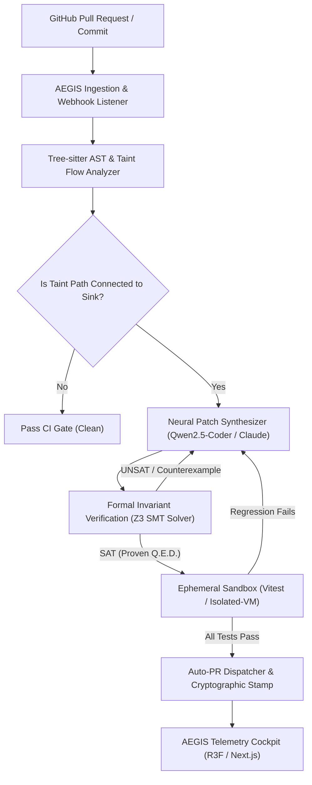

# Memory Bank: System Patterns
<!-- System Architecture, Component Relationships, and Design Decisions -->

## Key Architectural Patterns
1. **Pipeline Architecture:** Ingestion -> AST Parsing -> Taint Tracing -> Neuro-Symbolic Synthesis -> SMT Verification -> Sandboxed Regression -> Verified Dispatch.
2. **Actor / Isolation Pattern:** Sandbox execution runs within memory-isolated containers or Node isolates to prevent malicious payload execution during verification.
3. **Formal Invariant Boundary:** Every patch must be accompanied by a mathematically verifiable predicate before reaching the test execution chamber.
4. **Audit Trail Immutability:** Every verified patch records a SHA-256 cryptographic signature, SMT solver constraint count, and timestamp.
